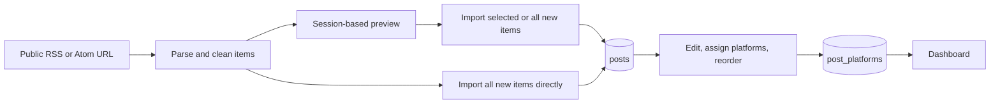

# RSS Post Manager: functionality and implementation

This document describes the application **as it is implemented in this repository**. For a short introduction and installation checklist, see [README.md](README.md).

## What the application does

RSS Post Manager is a CodeIgniter 3 workspace for turning items from public RSS or Atom feeds into editable posts. A user can preview a feed and choose items, or import all new items directly without a preview. They can then order posts by priority, assign social platforms, and review those assignments on a dashboard. The application prepares and organizes content; it does not publish to social networks.



### Feed import: user flow

1. Open **Import feed** (also the default page), enter a public `http://` or `https://` feed URL, and choose **Newest first** or **Oldest first**.
2. Choose **Import now** to parse the feed and save every new item immediately, skipping the preview. The completion area reports imported and skipped counts and links to Posts.
3. Alternatively, choose **Preview posts** to inspect items before saving. The inline preview shows each item's title, image when available, publication date, character count, and content preview, plus total, new, and duplicate counts.
4. In the preview, select individual new items, use **Select all new**, or clear the selection. **Remove duplicates** hides marked duplicates from the preview; it does not delete existing posts. Duplicates are skipped by either preview import action.
5. Use **Import selected** to save the chosen items, or **Import all new** to save every nonduplicate preview item. The completion area reports imported and skipped counts and links to Posts.

The server keeps a preview in the current session for **30 minutes**. Import from preview requires its random token and uses it only once; load the feed again to make another preview import. **Import now** sends the URL and sort order directly to the server and does not require or create a preview token; starting it clears any earlier preview selection. Either path appends imported posts in the selected order, leaves them without platform assignments, and checks duplicates when saving. An item imported after a preview was generated is skipped if a later preview import tries to save it.

### Posts: user flow

- **Browse:** Posts are ordered by ascending priority, 10 per page. The page has Card and List layouts, a post count, numbered pagination, a page summary, and First/Previous/Next/Last controls when applicable. The selected layout is kept in browser `localStorage`.
- **Edit:** The scrollable edit modal changes a post's title and content and assigns platforms with switch-style controls. It shows a live character count and highlights selected platforms whose configured limit is exceeded. Saving is allowed even when over a limit; the Posts card shows a compact warning that expands to the affected platforms, limits, and amount over.
- **Delete:** A confirmation modal removes the post and its platform assignments. Later priorities are shifted to close the gap.
- **Reorder:** Drag a card by its handle onto the same-size dashed drop target, or focus the handle and use Up/Down arrow keys. jQuery UI Sortable saves the resulting order through AJAX. Reordering applies to the **current 10-post page**; it does not move an item between pages.

If there are no posts, the page shows an import link instead of cards and pagination.

### Dashboard: user flow

The dashboard starts with **All assigned**, which includes only posts assigned to at least one platform. It shows the total imported count, assigned count, and a count for each platform. Selecting a platform filters the cards to that platform. Sort controls offer priority, publication date, character count, or title, in ascending or descending order. Results are paginated at 10 posts per page.

Each card shows the image or placeholder, priority, date, character count, excerpt, and assigned platform badges. If its content exceeds any assigned platform limit, the card lists the affected platforms, their limits, and how many characters over the limit it is. Filters, sort changes, and pagination update the results through AJAX while changing the browser URL. Empty states cover no imported posts, no assignments, and no posts for a selected platform.

### Platform limits

The platform list and limits come from `social_platforms`, seeded by [database.sql](database.sql):

| Platform | Maximum characters |
| --- | ---: |
| Facebook | 63,206 |
| X (Twitter) | 280 |
| LinkedIn | 3,000 |
| Instagram | 2,200 |
| TikTok | 2,200 |
| Threads | 500 |
| Bluesky | 300 |

These limits are **advisory** in this application: a post can be assigned and saved while over its limit. The editor, Posts cards, and Dashboard show warnings rather than truncating or blocking content.

## Technology and project structure

| Layer | Current implementation |
| --- | --- |
| Server framework | Bundled CodeIgniter **3.1.13** on PHP **7.4+** |
| Database | MySQL or compatible MariaDB through CI's `mysqli` driver; InnoDB tables using `utf8mb4` |
| Feed parser | Custom PHP `Rss_parser` using cURL, SimpleXML, and DOM; RSS 2.0 and Atom |
| Server-side text count | PHP `mb_strlen(..., 'UTF-8')` in `Char_counter` |
| Client UI | Bootstrap 5.3.3, Bootstrap Icons 1.11.3, jQuery 3.7.1, and jQuery UI Sortable 1.14.2 |
| Styling and interactions | Local `assets/css/*.css` and `assets/js/*.js`; third-party frontend files load from CDNs |
| Composer | [composer.json](composer.json) requires SimplePie `^1.8`, although the current feed parser uses SimpleXML rather than SimplePie |

### Main code files

| File | Responsibility |
| --- | --- |
| [application/controllers/Feed.php](application/controllers/Feed.php) | Import page, feed preview and token, direct import, and import request validation |
| [application/controllers/Posts.php](application/controllers/Posts.php) | Posts page and partial, pagination, edit, delete, and reorder endpoints |
| [application/controllers/Dashboard.php](application/controllers/Dashboard.php) | Dashboard filters, totals, sorting, pagination, and partial response |
| [application/libraries/Rss_parser.php](application/libraries/Rss_parser.php) | Fetch and parse public RSS/Atom XML; extract normalized items and images |
| [application/libraries/Char_counter.php](application/libraries/Char_counter.php) | UTF-8 content character count |
| [application/models/Post_model.php](application/models/Post_model.php) | Post queries, duplicate checks, transactional import, deletion, and priority reorder |
| [application/models/Platform_model.php](application/models/Platform_model.php) | Platform list, slug lookup, and assignment counts |
| [application/models/Post_platform_model.php](application/models/Post_platform_model.php) | Post/platform joins and replacing a post's assignments |
| [application/helpers/app_helper.php](application/helpers/app_helper.php) | Text cleaning, safe HTTP(S) URL check, and common JSON response |
| [application/views/layouts/header.php](application/views/layouts/header.php), [footer.php](application/views/layouts/footer.php) | Shared sidebar, top bar, CSRF metadata, assets, scripts, and toast markup |
| [application/views/feed/import.php](application/views/feed/import.php) | Feed form and direct-import button, inline preview, selection controls, and completion state |
| [application/views/posts/index.php](application/views/posts/index.php), [list.php](application/views/posts/list.php), [_card.php](application/views/posts/_card.php) | Posts shell, paginated list, individual card markup |
| [application/views/partials/modal_edit.php](application/views/partials/modal_edit.php), [modal_delete.php](application/views/partials/modal_delete.php) | Edit and delete dialogs |
| [application/views/dashboard/index.php](application/views/dashboard/index.php), [content.php](application/views/dashboard/content.php) | Dashboard shell and replaceable results/filters |
| [assets/js/feed.js](assets/js/feed.js), [posts.js](assets/js/posts.js), [dashboard.js](assets/js/dashboard.js) | Page-specific AJAX and interactions |
| [assets/css/app.css](assets/css/app.css), [feed.css](assets/css/feed.css), [posts.css](assets/css/posts.css), [dashboard.css](assets/css/dashboard.css) | Shared layout and page-specific styles |

The shared layout uses a responsive sidebar that becomes a Bootstrap offcanvas menu on smaller screens. `header.php` loads the shared stylesheet plus the active page's stylesheet; `footer.php` loads the page's JavaScript. jQuery UI is loaded only on Posts. The default route points to Feed, so the stock `Welcome` controller is not part of the main workflow.

## HTTP routes and request contract

Routes are defined in [application/config/routes.php](application/config/routes.php). Paths below are relative to the configured base URL (currently `http://localhost/practical_anuj/`).

| Method and path | Input | Result |
| --- | --- | --- |
| `GET /` or `GET /feed` | None | Full feed import page |
| `POST /feed/preview` | `feed_url`, `sort_mode` (`ASC`/`DESC`) | JSON with preview token, items, and total/new/duplicate counts |
| `POST /feed/import` | `token`, `mode` (`selected`/`all`), `selected[]` indices for selected mode | JSON with imported and skipped counts |
| `POST /feed/import_direct` | `feed_url`, `sort_mode` (`ASC`/`DESC`) | Parses the feed and imports all new items without preview; JSON with imported and skipped counts |
| `GET /posts` | Optional `page` | Full Posts page |
| `GET /posts/list` | Optional `page` | JSON with rendered list HTML and total post count |
| `POST /posts/update` | `id`, `title`, `content`, optional `platforms[]` | JSON with updated card HTML and limit warnings |
| `POST /posts/delete` | `id` | JSON with new total |
| `POST /posts/reorder` | Ordered `ids[]`, `page` | JSON confirming the priority change |
| `GET /dashboard` | Optional `platform`, `sort`, `dir`, `page` | Full Dashboard page |
| `GET /dashboard/filter` | Same query parameters | JSON with rendered dashboard content HTML |

`app_json()` returns responses in this shape:

```json
{
  "status": "success",
  "message": "Posts loaded.",
  "data": {
    "html": "...",
    "csrf_hash": "..."
  }
}
```

Error responses use `status: "error"` and an HTTP error code. The Feed and Posts scripts send the current CSRF token from the page's `<meta>` tags with POST requests and update it from `data.csrf_hash` afterward. The Dashboard uses GET partial routes for filters and page changes without a full reload.

## Data model and rules

The schema is in [database.sql](database.sql). It creates three InnoDB tables:

| Table | Important columns and rules |
| --- | --- |
| `posts` | `id`, `title` (up to 500 characters), `content`, optional `image_url`, `char_count`, `pub_date`, `priority`, `feed_url`, `created_at`; indexes on priority, publication date, and a feed URL prefix |
| `social_platforms` | `id`, `name`, unique `slug`, icon class, color, and `max_chars`; seven rows are seeded |
| `post_platforms` | `post_id` and `platform_id` assignment pair, unique together; indexed by platform |

The schema has **no foreign keys**. The application deletes a post's assignments in `Post_model::delete_and_shift()`. Post priority is an ascending integer order: imports append after existing posts, deletion shifts later numbers down, and reordering rewrites positions so the sequence remains contiguous.

`Post_model::total()` and `page()` support unfiltered Posts queries and assigned-only or platform-specific Dashboard queries. Dashboard sort fields are limited to priority, date, characters, and title; post ID breaks ties. The controller clamps page numbers to the available range.

### Parsing, normalization, and duplicates

`Rss_parser` accepts only RSS **2.0** and Atom XML from public HTTP(S) hostnames on ports 80 or 443. It validates the URL and DNS results, pins the resolved address for the cURL request, follows a bounded redirect chain, uses a 5-second connection/10-second request timeout, and caps the response body at 5 MiB. XML is loaded with `LIBXML_NONET`. An invalid or unavailable feed returns a preview error without leaving a previous preview available to import.

For each feed item, the parser chooses RSS `content:encoded` or description, or Atom content or summary; it extracts a safe image URL from an enclosure, Media RSS entry, or first HTML image. It removes script/style blocks and HTML tags, decodes entities, normalizes whitespace, limits titles to 500 UTF-8 characters, counts cleaned content, and uses the current time if a publication date cannot be parsed. Relative or non-HTTP(S) image URLs are not kept.

Duplicate identity is a normalized lowercase title plus **publication date**, or the same title plus **content**. Preview distinguishes an item already in the library from a repeat within the feed. Preview import skips marked duplicates and checks again inside a database transaction. Direct import runs the same duplicate-safe transactional insertion after parsing and sorting, including repeats within the feed. A MySQL named lock serializes imports so two import requests cannot both pass the check at the same time. Duplicate uniqueness is application logic, not a database unique key. The existing-post lookup first queries the exact stored title, so case or whitespace variants of that title may not always be detected as duplicates.

### Edit and assignment behavior

On edit, the server cleans text again, truncates the title to 500 UTF-8 characters, requires nonempty title and content, and accepts only platform IDs present in `social_platforms`. It saves the post and replaces its assignment rows in one transaction. The stored `char_count` is calculated from cleaned content with `mb_strlen`; the browser uses a live JavaScript character count for feedback. The server reports the names of assigned platforms over their limits after a successful save.

## Configuration and running locally

1. Use PHP 7.4 or newer with `curl`, `mbstring`, `mysqli`, `dom`, and `SimpleXML`; start Apache and MySQL (or compatible MariaDB).
2. Import [database.sql](database.sql) into a fresh database. It creates `rss_manager`, its tables, and platform seed rows. This is an initialization script, not a repeatable migration.
3. Set database host, credentials, and database name in [application/config/database.php](application/config/database.php). The shipped connection uses `mysqli` and `utf8mb4`.
4. Set `base_url` in [application/config/config.php](application/config/config.php) for your local path. The shipped value is `http://localhost/practical_anuj/`.
5. Enable Apache `mod_rewrite` and `AllowOverride All` so [.htaccess](.htaccess) can route requests without `index.php` in the URL. Open the configured base URL.

CodeIgniter autoloads the database, session, and form-validation libraries and the URL, form, and app helpers. Sessions use files. Composer autoloading is enabled only when `vendor/autoload.php` exists; `composer install` is needed for the declared SimplePie package but the implemented parser itself uses PHP's XML extensions. CSRF protection is enabled with token regeneration; the application entry point defaults to the `production` environment unless `CI_ENV` is set.

## Current scope and implementation limits

- There are no login accounts, user permissions, social-network API publishing, scheduled publishing jobs, or media uploads. Images are remote URLs supplied by feeds.
- The dashboard intentionally excludes unassigned posts from **All assigned**; newly imported posts appear there only after platform assignment.
- Character limits warn but do not prevent saving. Platform assignments do not change a post's content automatically.
- Drag sorting changes priority within the currently displayed Posts page. Use pagination to view other groups of ten.
- Feed URLs must be public HTTP(S) hostnames on standard ports. Duplicate detection is based on the application's matching rules and is not guaranteed by a database uniqueness constraint.
